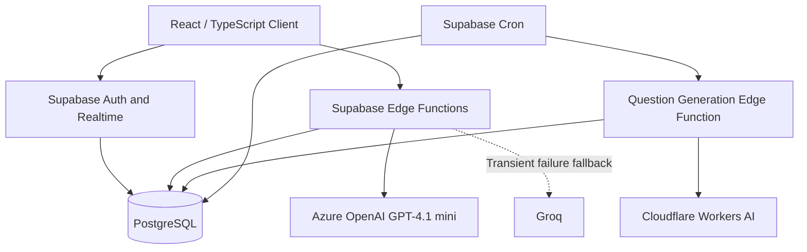

# CONMAN

**The Art of Argument.**

CONMAN is a competitive game of wit, creativity, and persuasion. Players take on unconventional courtroom cases, construct arguments under time pressure, and compete to convince an AI judge. No legal or specialized knowledge is required.

**[Play CONMAN](https://conman-pi.vercel.app)**

## Gameplay

> Your client removed every clock from the office. How would you convince the judge this made employees better at meeting deadlines?

Every case presents an unfamiliar position to defend. There is no predetermined correct answer: the challenge is to find an unexpected, logically defensible argument.

Players receive 7 seconds to prepare, followed by 25 seconds to type or 20 seconds to speak their argument. The AI judge evaluates responses across five dimensions: logic, creativity, relevance, clarity, and depth, each scored out of 10.

## Features

- **Daily Five:** Five shared cases published each day, with scores and leaderboard competition.
- **Ranked Arena:** Real-time head-to-head matchmaking with synchronized rounds and Elo-based rankings.
- **Friend Challenges:** Private, unranked matches against friends.
- **Voice and Typing:** Timed written arguments or speech recognition on supported browsers.
- **Social:** User profiles, following, mutual-follow friendships, and friend invitations.
- **AI Judging:** Structured argument evaluation with automatic provider fallback for transient failures.
- **Automated Question Generation:** Continuously refreshed question pools without manual question authoring.

## Architecture



The frontend is deployed on Vercel. Supabase handles authentication, persistence, real-time game synchronization, server-side game logic, and scheduled jobs. AI provider credentials remain on the backend.

## Engineering Highlights

### Real-time multiplayer

The multiplayer system uses server-authoritative deadlines and synchronized game state so both players receive the same case and timing rules. Versioned answer updates protect against stale writes, while matchmaking attempt identifiers and transactional state transitions handle cancellation, expiration, and concurrent matching requests. Ranked results update Elo; private friend challenges do not.

### Reliable AI evaluation

Azure OpenAI GPT-4.1 mini serves as the primary judge, with Groq as a fallback for transient failures and rate limits. Both players' arguments in a competitive round are evaluated jointly by a single model to maintain consistent judging. Answers are persisted before evaluation, structured scores are validated, and grading protections prevent duplicate results during retries.

### Autonomous content pipeline

Cloudflare Workers AI generates new courtroom-style cases. The pipeline validates question formatting, screens for duplicates, and records generation activity. Scheduled PostgreSQL jobs maintain the question supply:

| Job | Schedule / target |
| --- | --- |
| Daily reserve refill | Every 10 hours; target of 35 unused questions |
| Daily publication | 11:30 PM America/New_York; prepares the next daily challenge |
| Arena rotation | Every 6 hours; rotates 10 questions and maintains a target bank of 150 |

Question snapshots and historical records preserve the original case assignments of existing attempts when the available question pools change.

## Tech Stack

| Layer | Technology |
| --- | --- |
| Frontend | React, TypeScript, Vite, Tailwind CSS |
| Backend | Supabase Edge Functions, PostgreSQL, PL/pgSQL |
| Authentication & real-time updates | Supabase Auth, Supabase Realtime |
| AI judging | Azure OpenAI GPT-4.1 mini, Groq |
| Question generation | Cloudflare Workers AI (Gemma) |
| Scheduling | Supabase Cron / pg_cron |
| Hosting | Vercel |

## Local Development

Prerequisites: Node.js, npm, and a Supabase project for backend services.

```bash
git clone https://github.com/Pratyush-0-8/CONMAN.git
cd CONMAN
npm install
npm run dev
```

Configure the frontend environment using the Supabase URL and public client key expected by the application. The development server prints its local URL.

For the full application, configure an independent Supabase project with the repository's database migrations and Edge Functions. Set the AI provider credentials and scheduled jobs in that project; the production service credentials are not distributed with this repository.

The judging backend uses these Azure secret names:

- `AZURE_OPENAI_ENDPOINT`
- `AZURE_OPENAI_DEPLOYMENT`
- `AZURE_OPENAI_API_KEY`

The Groq fallback and Cloudflare question generator require their own server-side credentials. Keep all private API keys and service-role credentials out of frontend environment variables and source control.

## Build

```bash
npm run build
```

## Project Goals

CONMAN explores how language models can support competitive, open-ended games rather than traditional questions with fixed answers. The project combines creative reasoning with the engineering challenges of synchronized multiplayer state, reliable AI evaluation, and automated content generation.
